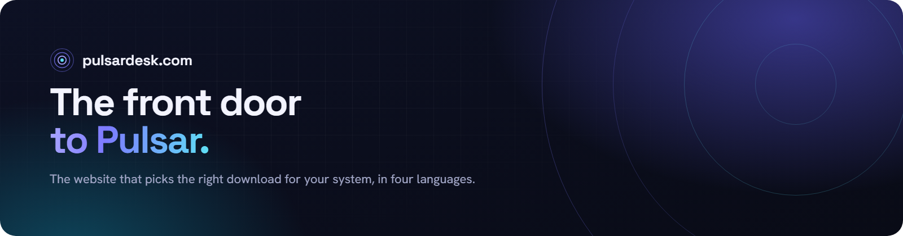

<p align="center">
  <a href="https://pulsardesk.com"></a>
</p>

<p align="center">The <a href="https://pulsardesk.com">pulsardesk.com</a> website for Pulsar, the free remote desktop and game streaming app. 🌐</p>

<p align="center">
  <a href="https://github.com/PulsarDesk/web/actions/workflows/ci.yml"></a>
  <a href="https://github.com/PulsarDesk/web/stargazers"></a>
  <a href="LICENSE"></a>
</p>

<p align="center">
  <b>Looking for the app?</b> 👉 <a href="https://github.com/PulsarDesk/pulsar-desktop"><b>Pulsar Desktop</b></a> (Windows, macOS, Linux) · <a href="https://github.com/PulsarDesk/pulsar-mobile"><b>Pulsar Mobile</b></a> (Android)
</p>

---

## 🚀 Project Status
Live at [pulsardesk.com](https://pulsardesk.com), in English, Turkish, Kazakh and Russian. The download page always
points at the newest release of each app.

---

## 📦 Other Pulsar Repositories
- [**pulsar-desktop**](https://github.com/PulsarDesk/pulsar-desktop) - Pulsar for Windows, macOS and Linux
- [**pulsar-mobile**](https://github.com/PulsarDesk/pulsar-mobile) - Pulsar for Android
- [**design**](https://github.com/PulsarDesk/design) - Colors, fonts and designs (the site copies them from here)

---

## 🐞 Reporting a bug
[Open an issue](https://github.com/PulsarDesk/web/issues/new/choose) with the page link, your browser and a
screenshot. Problems with the app itself go to [pulsar-desktop](https://github.com/PulsarDesk/pulsar-desktop/issues/new/choose)
or [pulsar-mobile](https://github.com/PulsarDesk/pulsar-mobile/issues/new/choose).

---

## 🤝 Contributing
Everyone can open [issues](https://github.com/PulsarDesk/web/issues) and pull requests. Irrelevant or abusive issues
may be closed or removed. Translations are welcome. Commits follow [Conventional Commits](https://www.conventionalcommits.org).

### Development Guide
```bash
git clone https://github.com/PulsarDesk/web.git
cd web
bun install
bun run dev          # http://localhost:5173
bun run test         # unit tests
bun run test:e2e     # browser tests
```

SvelteKit on Cloudflare Workers. Colors and spacing come from
[design/tokens.css](https://github.com/PulsarDesk/design/blob/main/project/assets/tokens.css); change them there first.

---

## 📄 License
Pulsar is licensed under **GNU GPLv3 or later** (GPL-3.0-or-later). See the [LICENSE](LICENSE) file for details.
