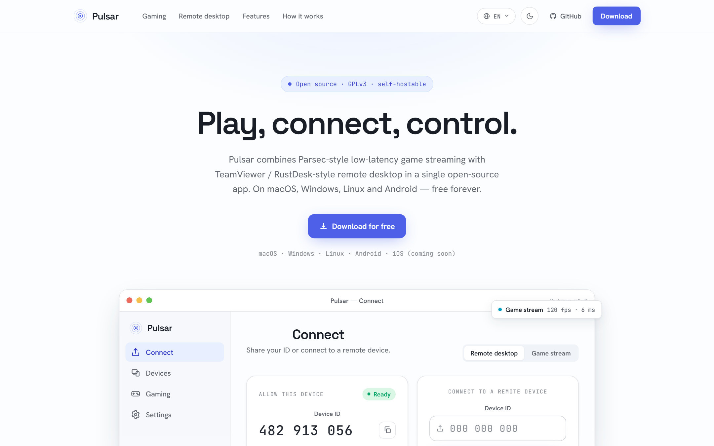
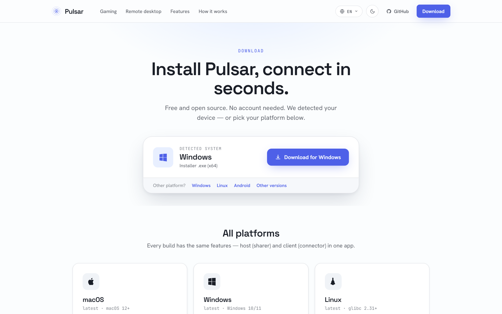

<p align="center">
  <a href="https://pulsardesk.com"></a>
</p>

<h3 align="center">The front door to Pulsar.</h3>

<p align="center">
  The source of <a href="https://pulsardesk.com"><b>pulsardesk.com</b></a>: what Pulsar is, how it works,
  and the right download for your device in one click.
</p>

<p align="center">
  <a href="https://pulsardesk.com"></a>
  <a href="https://pulsardesk.com/download"></a>
</p>

<p align="center">
  <a href="https://github.com/PulsarDesk/web/actions/workflows/ci.yml"></a>
  <a href="https://github.com/PulsarDesk/web/stargazers"></a>
  
  <a href="LICENSE"></a>
</p>

## 👀 The site

<table>
<tr>
<td width="50%"></td>
<td width="50%"></td>
</tr>
<tr>
<td align="center"><b>Home</b> · Pulsar in one screen</td>
<td align="center"><b>Download</b> · spots your system and offers the right file</td>
</tr>
</table>

## ✨ What it does

<table>
<tr>
<td width="33%" valign="top">

### 🎯 One-click download
The download page recognises your device (Windows, macOS, Linux, Android) and always points at the newest
release of each app.

</td>
<td width="33%" valign="top">

### 🌍 Four languages
English, Turkish, Kazakh and Russian. The site picks your language, and remembers it when you switch.

</td>
<td width="33%" valign="top">

### 🌗 Light and dark
Follows your system theme, with a toggle in the header. Same colors and fonts as the apps.

</td>
</tr>
</table>

## 🐞 Reporting a bug

Something wrong on the site? [Open an issue](https://github.com/PulsarDesk/web/issues/new/choose) with the page link,
your browser and a screenshot. Problems with the app itself go to
[pulsar-desktop](https://github.com/PulsarDesk/pulsar-desktop/issues/new/choose) or
[pulsar-mobile](https://github.com/PulsarDesk/pulsar-mobile/issues/new/choose).

## 🌐 Help translate

Translations are welcome. All site text lives in [`src/lib/i18n/translations.ts`](src/lib/i18n/translations.ts):
fix a phrase, or add a language, and open a pull request.

## 🛠️ For developers

<details>
<summary>Run the site locally</summary>

**Needs:** [bun](https://bun.sh).

```bash
git clone https://github.com/PulsarDesk/web.git
cd web
bun install
bun run dev          # http://localhost:5173
bun run test         # unit tests
bun run test:e2e     # browser tests
```

SvelteKit with server rendering on Cloudflare Workers. Colors and spacing come from
[design/tokens.css](https://github.com/PulsarDesk/design/blob/main/project/assets/tokens.css); change them there
first.

</details>

Everyone is welcome to open [issues](https://github.com/PulsarDesk/web/issues) and pull requests. Irrelevant or
abusive issues may be closed or removed. Commits follow [Conventional Commits](https://www.conventionalcommits.org).

## 🌌 The Pulsar family

| | Project | |
|---|---|---|
| 🖥️ | [**Pulsar Desktop**](https://github.com/PulsarDesk/pulsar-desktop) | Pulsar for Windows, macOS and Linux |
| 📱 | [**Pulsar Mobile**](https://github.com/PulsarDesk/pulsar-mobile) | Pulsar for Android phones, tablets and TVs |
| 🛰️ | [**Pulsar Relay**](https://github.com/PulsarDesk/relay) | Run your own Pulsar server |
| 🎨 | [**Pulsar Design**](https://github.com/PulsarDesk/design) | Colors, fonts and designs (the site copies them from here) |

## 📄 License

Pulsar is free software under the **GNU GPLv3 or later** (GPL-3.0-or-later). See [LICENSE](LICENSE).

<p align="center">
  <br>
  <b>Like Pulsar? A ⭐ helps other people find it.</b>
</p>
